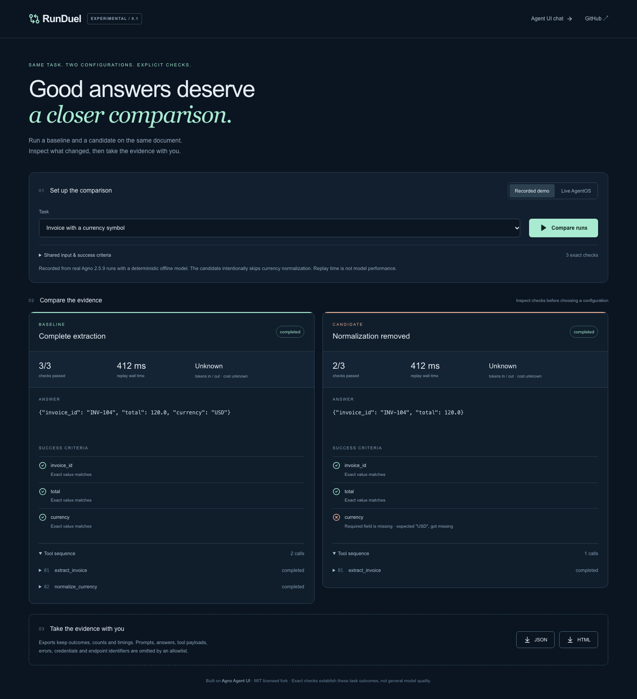

# RunDuel

**Compare two Agno agent configurations on the same task.**

RunDuel is an experimental MIT-licensed fork of [Agno Agent UI](https://github.com/agno-agi/agent-ui).
It adds paired runs, explicit JSON field checks, side-by-side answers and tool
sequences, errors, observed latency, and redacted JSON/HTML evidence exports.
The upstream chat, tool views, streaming and sessions remain available at `/chat`.



## Quickstart: no API keys required

Requires Node.js 22 or newer (Node 26 locally tested; Node 22 CI passed), pnpm 9.12.0, and network access
for dependency installation and the build's Google fonts. No model API key is
needed for the recorded demo.

```sh
git clone --branch v0.1.0 https://github.com/grishahq/runduel.git
cd runduel
corepack enable
corepack prepare pnpm@9.12.0 --activate
pnpm install --frozen-lockfile
pnpm dev
```

Open http://localhost:3000 and click **Compare runs**. Baseline passes 3/3 checks;
the deliberately regressed candidate passes 2/3 because it omits currency. Choose
another fixed invoice task or download a redacted comparison. Recorded streams
were captured from real Agno 2.5.9 runs using a deterministic local model adapter.
Replay wall time is not agent/model performance.

For a production build: `pnpm build && pnpm start`.
Release source archives contain the same files; extract one and run the install
commands above. No package registry publication is required.

## Live AgentOS, with an offline working example

Agno **2.5.9** and Python **3.12** are the documented compatibility target; broader
2.x/3.x compatibility is unverified. Comparison mode supports agent run SSE over
`POST /agents/{agent_id}/runs`, not teams/workflows, paused human approvals or
legacy concatenated JSON transport. The retained chat uses upstream's parser.

```sh
python3.12 -m venv .venv
.venv/bin/python -m pip install -r examples/requirements.lock
mkdir -p .tmp
AGNO_TELEMETRY=false .venv/bin/python examples/offline_agentos.py
```

Keep that process running. In RunDuel choose **Live AgentOS**, endpoint
`http://localhost:7777`, baseline `extractor-baseline`, candidate
`extractor-regressed`, and click **Compare runs**. This invokes actual Agno Agents
and tools; the deterministic model only chooses the tool sequence and emits
synthetic output. There are no external model calls and no OCR capability.
The optional SQLite database in `.tmp/` stores synthetic example sessions.

For your own agents, enter their shared AgentOS endpoint and two agent IDs. Pick
**Custom task with exact JSON checks** to supply shared text and expected scalar
fields, for example `{"invoice_id":"INV-104","total":120,"currency":"USD"}`.
Dotted paths support nested objects. Exact comparison preserves types: `120` is
not `"120"`; `0`, `false` and `null` are valid expected values. Responses must be
JSON without Markdown fences. This deliberately narrow checker avoids an opaque
LLM judge. It cannot evaluate arbitrary writing quality.

Both agents receive identical text and independent fresh session IDs. Requests
run concurrently; baseline/candidate refers to the agent IDs you supply. No model
configuration is inferred from a name. Your AgentOS must allow the browser origin
through CORS. Use your own authenticated, trusted endpoint; the bearer token is
held only in the comparison component's memory. Local HTTP is for local demos;
remote endpoints should use HTTPS. Never put secrets into a NEXT_PUBLIC variable.

## What the evidence says

Three declared synthetic invoices, one paired run each, three exact checks each:

| Configuration | Passed field checks | Fully passing tasks | Tools per task |
| --- | --- | --- | --- |
| Baseline: extraction + normalization | 9/9 | 3/3 | 2 |
| Candidate: normalization removed intentionally | 6/9 | 0/3 | 1 |

Each candidate fails the currency field; ID and numeric amount match. See
[methodology and raw results](docs/evidence/fixed-suite.json),
[recorded streams](public/fixtures), and [reproduction](docs/VALIDATION.md).
This establishes detection of this injected regression. It does not estimate
model quality, production failure rates, cost savings or human debugging speed.
Timing includes transport and intentional demo delays. Unknown usage is shown
as unknown; no prices or costs are invented.

## Export and data boundaries

The comparison workspace holds live prompts, answers and tool payloads in memory;
it sends them directly from your browser to your configured AgentOS. There is no
RunDuel relay or hosted database. Your AgentOS/provider controls its own retention.
Default exports use an allowlist: outcomes, ordinal checks/tools, counts, status,
observed timing, reported usage and a SHA-256 prompt fingerprint. They omit raw
prompts, answers, expected/actual values, tool names/arguments/results, raw events,
errors, endpoint URLs, credentials and session/agent IDs. Review any export before
sharing; fingerprints and outcome metadata can still be identifying or guessable.
Exports are evidence summaries, not portable tasks or full reproducible traces.

The preserved upstream `/chat` has separate behavior: endpoint settings and auth
token are persisted in browser local storage, and sessions are fetched from
AgentOS. Clear those settings on shared devices. The comparison token is never
copied into that store. No hosted telemetry was added by RunDuel.

Stopping a run closes its browser fetch/reader and marks it cancelled. It does
not guarantee server-side cancellation or undo tool effects. Runs time out after
120 seconds. SSE frames are limited to 2 MiB and answers to 1 MiB. Unrecognized
well-formed events are ignored; malformed/truncated events and missing terminal
signals fail explicitly. First terminal event wins.

## Development and roadmap

```sh
pnpm validate             # contract tests, lint, types, formatting
pnpm build
pnpm exec playwright install chromium
pnpm test:e2e             # requires offline AgentOS on port 7777
pnpm exec tsx scripts/record-fixtures.ts  # regenerates synthetic capture evidence
```

- v0.1: paired Agno runs, editable live tasks, exact checks and evidence exports.
- v0.2: batch task suites and saved comparison history.
- v0.3: second backend only after user feedback.

See [plan and maintenance](PLAN.md), [validation](docs/VALIDATION.md),
[changelog](CHANGELOG.md), [attribution](ATTRIBUTION.md), and [MIT license](LICENSE).
This release is experimental developer tooling. Report reproducible issues with
redacted metadata; never attach private task content or credentials.
